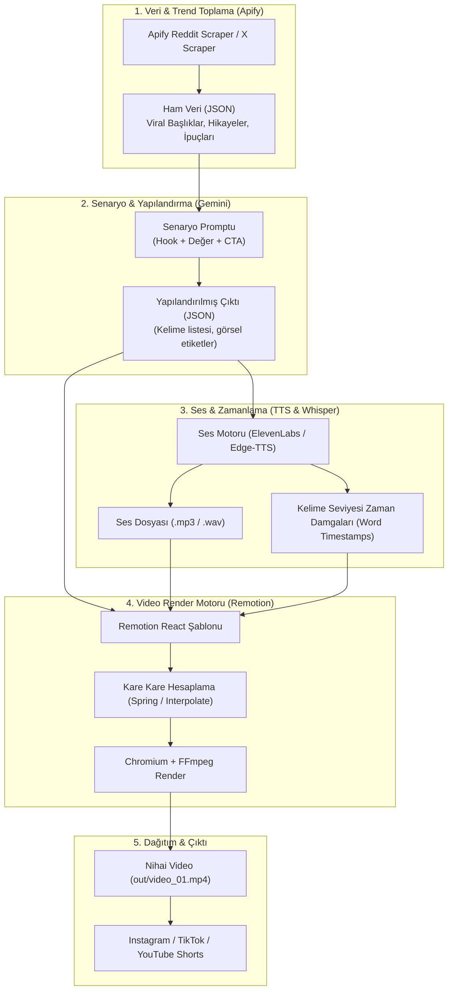

# 🚀 Otonom Video Üretim Mimarisi (Remotion + Gemini + Apify)

Bu belge; viral sosyal medya videoları (Reels, Shorts, TikTok) üretmek için Gemini ve Remotion destekli uçtan uca otonom video üretim fabrikasının mimarisini ve prompt şablonlarını açıklar.

---

## 🏗️ 1. Sistem Mimarisi Şeması



---

## 🧩 2. Mimari Katmanların Detayları

### Katman 1: Veri Toplama (Apify)
* **Amaç:** Nişinize göre (yazılım, tarih, psikoloji, finans, Reddit) internetteki en yüksek etkileşimli içerikleri toplamak.
* **Kullanılan Araçlar:**
  * Apify `reddit-scraper` (r/todayilearned, r/AskReddit, r/showerthoughts)
  * Apify `twitter-scraper` (Viral flood'lar ve alıntılar)
  * Apify `instagram-reel-scraper` (Rakiplerin en çok izlenen başlıkları)
* **Çıktı:** Konu başlığı, metin, etkileşim skoru içeren JSON verisi.

### Katman 2: Senaryo & Kurgu Motoru (Gemini)
* **Amaç:** Ham veriyi veya konuyu 40-50 saniyelik, ilk 1-2 saniyesi "Sorun / Paradoks Odaklı Hook" olan viral bir formüle dönüştürmek.
* **Zorunlu Hook Kuralı:** `[Konuya Özel Çarpıcı Sorun/Çelişki]` + `["Hiç merak ettin mi?" / "Cevabı ezber bozuyor..."]`
* **Formül:** `[0-3s Sorun/Paradoks Kancası]` ➔ `[3-8s Yönlendirme & Vaat]` ➔ `[8-35s İnfografik Çözüm & Gerçekler]` ➔ `[35-45s Sarsıcı Sentez Kapanışı (Klişe 'yoruma yaz' yasağı)]`.

### Katman 3: Seslendirme ve Altyazı Senkronizasyonu (TTS)
* **Araçlar:**
  * **Edge-TTS (Ücretsiz & Hızlı):** Microsoft'un Türkçe doğal sesleri (`tr-TR-AhmetNeural`, `tr-TR-EmelNeural`). API anahtarı gerekmez.
  * **ElevenLabs (Premium):** Derin, felsefi veya heyecanlı anlatıcı tonları.
* **Kritik Nokta:** Dinamik altyazı (kinetic typography) için kelime kelime zaman damgaları (`word: "Bilinmeyen", start: 0.42, end: 0.85`) üretilir.

### Katman 4: Remotion Şablon Mimarisi
Remotion tarafında **tek bir şablon** yüzlerce videoyu besleyebilmelidir.
* **Dizin Yapısı:**
  ```text
  src/
  ├── compositions/
  │   └── ReelVideo/
  │       ├── index.tsx          # Ana kompozisyon (Root Sequence)
  │       ├── KineticCaptions.tsx # Kelime kelime vurgulu altyazı
  │       ├── Background.tsx      # Neo-Brutalism Warm Cream dot-grid zemin
  │       ├── ProgressBar.tsx     # Üstteki izleme çubuğu
  │       ├── HeaderBadge.tsx     # Kategori başlık rozeti
  │       ├── HistoricalStamp.tsx # Sert çarpan Signal Orange arşiv damgası
  │       └── FactCard.tsx        # Sert gölgeli belge kartı
  ├── theme.ts               # Değiştirilebilir tema yapılandırması (Aktif: Neo-Brutalism)
  ├── types/
  │   └── schema.ts          # Video Props TypeScript arayüzü
  └── Root.tsx
  ```

### 🎨 Neo-Brutalism Tasarım & Renk Değişkenleri
* **%50 — Warm Cream (`#F4F0E6`):** Ana arka plan ve geniş zeminler.
* **%30 — Ink Black (`#171717`):** Tipografi, `4px solid #171717` sert çerçeveler ve `8px 8px 0px #171717` sert gölgeler.
* **%15 — Acid Yellow (`#DFFF00`):** Altyazı aktif kelime kutuları, vurgu etiketleri.
* **%5 — Signal Orange (`#FF5A36`):** Arşiv damgaları, acil uyarı rozetleri.
* **Pure White (`#FFFFFF`):** Kart zeminleri ve ters kontrast alanları.

---

## ✍️ 3. Prompt Mühendisliği Rehberi (Şablonlar)

### 📌 Prompt Tipi 1: Viral Senaryo Üretim Promptu (Gemini İçin)
Bu prompt, ham konuyu veya Apify'dan gelen veriyi videoya dönüştürmek için kullanılır:

```markdown
Rol: 10 milyon izlenmeli dikey kısa video (Reels/Shorts) metin yazarı ve kurgucususun.
Hedef: Aşağıdaki konudan 25-30 saniyelik yüksek kancalı (high-retention) bir video metni oluştur.

Konu / Veri: [BURAYA APİFY VERİSİ VEYA KONU GELECEK]
Hedef Kitle: [Örn: Meraklı gençler, girişimciler, yazılımcılar]
Ton: [Örn: Gizemli, felsefi, enerjik]

Kurallar:
1. İLK 3 SANİYE (Hook): İzleyicinin kaydırmasını imkansız kılacak, ezber bozan bir soru veya şaşırtıcı bir ifadeyle başla. Asla "Merhaba arkadaşlar" gibi girişler yapma.
2. Cümleler kısa ve ritmik olmalı (maksimum 6-8 kelimelik vurucu cümleler).
3. Son 3 saniye merak uyandıran bir soruyla yoruma veya takip etmeye yönlendirmeli.

Çıktıyı SADECE aşağıdaki JSON formatında ver:
{
  "title": "Videonun Başlığı",
  "hook": "İlk 3 saniye cümlesi",
  "body": [
    "İkinci cümle metni.",
    "Üçüncü cümle metni.",
    "Dördüncü cümle metni."
  ],
  "cta": "Yorumlara fikrini yaz ve devamı için takip et.",
  "visualTheme": "dark-minimalist | cyberpunk | retro-terminal",
  "tags": ["psikoloji", "ilginçbilgiler", "gelişim"]
}
```

---

### 📌 Prompt Tipi 2: Remotion Bileşeni Üretim Promptu (Gemini / AI İçin)
Yeni bir animasyon veya bileşen kodlatırken kullanılan kesin kurallı prompt:

```markdown
Rol: Kıdemli Remotion & React Motion Graphics geliştiricisisin.
Görev: Remotion için 1080x1920 (9:16) boyutlarında modern bir "[BİLEŞEN_ADI]" oluştur.

Teknik Kurallar:
1. `useCurrentFrame()` ve `useVideoConfig()` hook'larını kullan.
2. Animasyonlarda CSS transition kullanma; Remotion'ın `spring()` veya `interpolate()` fonksiyonlarını kullan.
3. Spring config için: `{ fps, config: { damping: 12, mass: 0.5, stiffness: 100 } }` gibi akıcı fizik kullan.
4. TailwindCSS sınıflarını veya inline modern CSS kullan (koyu tema, glassmorphism, glowing efektleri).
5. Bileşen parametrik olmalı (`props` üzerinden metin, renk, süre alabilmeli).
6. Performans: Ağır canvas döngülerinden kaçın, GPU hızlandırmalı transform ve opacity kullan.
```

---

### 📌 Prompt Tipi 3: Dinamik Tipografi / Kelime Efekti Promptu
```markdown
Görev: Remotion için kelime kelime senkronize olan dinamik bir altyazı (Kinetic Captions) bileşeni yaz.
Özellikler:
- Altyazı o an konuşulan kelimeyi sarı renkte vurgulasın (#FACC15) ve hafifçe scale(1.1) büyütüp yaylanarak geri getirsin.
- Konuşulmayan kelimeler beyaz ve %70 opaklıkta kalsın.
- Kelime zaman damgaları (startFrame, endFrame) dizisi prop olarak gelsin.
- Yazı tipi kalın (font-black), gölgeli (drop-shadow-lg) ve ekranın ortasının biraz altında (top-[65%]) yer alsın.
```

---

## 🛠️ 4. Çalıştırma Akışı (Workflow)

```bash
# 1. Konu/Apify verisini çek
npm run fetch-data

# 2. Claude ile senaryo üret (data/script.json)
npm run generate-script

# 3. Ses dosyasını ve altyazı zamanlamalarını üret (public/voice.mp3)
npm run generate-audio

# 4. Remotion ile videoyu derle ve MP4 çıktısı al
npx remotion render Root InstagramReel out/video_final.mp4
```
