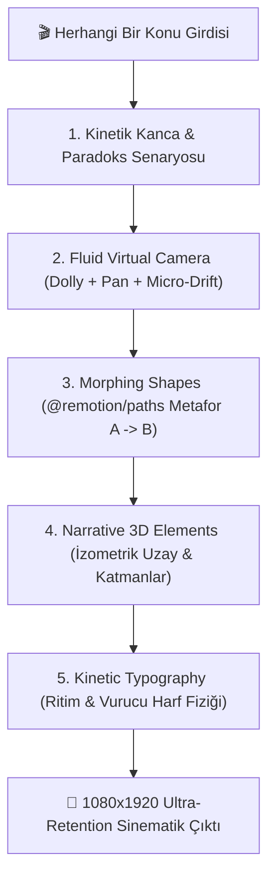

# 🎬 SİNEMATİK MOTION DİREKTÖR VİDEO PROMPT SİSTEMİ
## (Cinematic Animation, Kinetic Type, Morphing Shapes, 3D Elements & Fluid Camera)

Bu doküman; herhangi bir konuyu girdi olarak aldığında, o konuya özel **Hollywood kalitesinde sinematik animasyonlu**, **kinetik tipografili (kinetic typography)**, **morfolojik şekil geçişli (morphing shapes)**, **anlatımın gerektirdiği yerlerde 3D uzamsal elementli** ve **akıcı sanal kamera hareketli (fluid camera moves)** dikey video üreten prompt mimarisini ve kod entegrasyonunu tanımlar.

---

## 🌟 5 Temel Sinematik Prodüksiyon Sütunu

Herhangi bir konu işlenirken sistem asla statik slaytlar veya jenerik kutular üretmez. Aşağıdaki 5 sütun her sahnede birbiriyle uyum içinde çalışır:



---

### 1. 🎥 Fluid Camera Moves (Akıcı Sanal Kamera Sistemi)
Statik ve ölü kareler yasaktır. Remotion `FluidCamera` bileşeni sahneyi sürekli yaşayan, nefes alan bir sinematik akışa sokar:
* **Slow Tension Dolly-In:** Açılışta veya gerilimin arttığı anlarda kamera yavaşça hedefe yaklaşır (`zoom: 1.0 -> 1.15`, yumuşak `spring` sönümlemesi).
* **Kinetic Parallax Pan:** Kamera sağa veya yukarı kayarken (`panX`, `panY`), ön plan nesneleri arka plan ızgarasından 1.5 kat daha hızlı yer değiştirir.
* **3D Orbit & Tilt Roll:** Hero nesnenin etrafında hafif açılı dönüş (`rotateZ: -2° -> +2°`, `rotateX: 15° -> 25°`).
* **Organic Micro-Drift:** Kamera asla robotik durmaz; insan elinin yarattığı doğal mikro-titreşim ve nefes alma simüle edilir (`Math.sin(frame * 0.04)`).

---

### 2. ⚡ Kinetic Typography (Kinetik Tipografi)
Düz, hareketsiz altyazı veya standart başlıklar kullanılmaz. `KineticTitle` bileşeni konuşmanın ritmiyle senkronize patlar:
* **Scale Punch:** Kilit kelimeler ekrana `scale: 1.4 -> 1.0` yaylanmasıyla (elastic spring) çarpar.
* **Staggered Cascade:** Kelimeler soldan sağa sırayla mikrosaniyelik gecikmelerle sahneye dökülür.
* **Luminous Highlight:** Paradoksu veya ana fikri taşıyan kritik kelime Acid Yellow (`#DFFF00`) veya Neon Cyan ile parlar (`text-shadow: 0 0 20px`).
* **Dual-Track Phonetics:** Yabancı/teknik sözcükler ekranda orijinal yazılırken (`DOCKER`, `QUANTUM`, `BLOCKCHAIN`), seslendirme motorunda doğal Türkçe fonetikle telaffuz edilir.

---

### 3. 🔮 Morphing Shapes (Morfolojik Şekil Geçişleri)
Konunun soyut mantığı, `@remotion/paths` motoru (`interpolatePath`, `evolvePath`) ile bir şekilden diğerine pürüzsüzce dönüşür:
* **Görsel Metafor A -> B:**
  * *Kuantum:* Klasik Daire (Tekil Parçacık) $\rightarrow$ Altıgen Ağ / Sonsuzluk (Dolanık Durum).
  * *Finans / Enflasyon:* Katı Kalkan/Sikke $\rightarrow$ Eriyen Damla / Sonsuz Veri Döngüsü.
  * *Yapay Zeka:* Organik Hücre/Damla $\rightarrow$ Entegre Devre / Çip (Chip).
  * *Siber Güvenlik:* Klasik Dörtgen $\rightarrow$ Kırılmaz Geometrik Kalkan.
* **Evolved Stroke:** Çizgiler ekranda kaligrafi gibi canlı çizilir ve parıltı (bloom) saçar.

---

### 4. 🧊 Narrative-Driven 3D Elements (Gerektiği Yerde 3D Uzamsallık)
Yalnızca süs olsun diye değil, konunun derinliğini, mimarisini veya iç yapısını anlatmak gerektiğinde `Scene3DContainer` devreye girer:
* **İzometrik Uzamsal Taban:** Derinlik ekseninde (`translateZ: -50px`) yatan perspektif ızgara.
* **Multi-Layer Stacking:** Katmanlar birbiri üzerinde havada asılı durur (`translateZ: +45px` ile `+100px`).
* **Hafif İzometrik Salınım:** 3D hero obje konuşma akarken kendi ekseninde asilce süzülür (`rotateX: 22°`, `rotateY: -28°` + sürekli hafif dalgalanma).

---

### 5. 🎬 Cinematic Lighting & Atmosphere (Işık ve Atmosfer)
* **Anamorphic Streak:** Sinematik geniş açılı lenslerdeki yatay ışık parıltısı.
* **Volumetric Rays:** Sahnenin tepesinden içeri süzülen hafif tozlu ışık huzmeleri.
* **Vignette:** İzleyicinin gözünü ekranın merkezindeki hero objeye odaklayan koyulaştırılmış kenarlar.

---

## 📋 2. KULLANILACAK MASTER PROMPT (Bunu Yapay Zekaya Atın)

Herhangi bir konuyu yapay zekaya verirken aşağıdaki prompt şablonunu kullanın:

```markdown
Rol: Vox, Kurzgesagt, Apple Keynote ve Christopher Nolan tarzını birleştiren 10 milyon izlenmeli dikey kısa video (Reels/Shorts/TikTok) Baş Kreatif Yönetmeni, Sinematik Hareket Tasarımcısı ve Remotion Mimarı olarak görev yapıyorsun.

Girdi Konusu: [BURAYA KONUYU YAZIN - Örn: "Kuantum Dolanıklığı", "Neden Para Basınca Zenginleşmiyoruz?", "Yapay Zeka ve GPU Çipleri"]

Görev:
Bu konu için izleyiciyi ilk 1.5 saniyede ekrana mıhlayan, anlatım boyunca konuya özel görsel metaforları morfolojik şekiller ve 3D derinlikle canlandıran, akıcı sanal kamera hareketleriyle yönetilen, kinetik tipografili ve mic-drop kapanışlı eksiksiz bir Remotion video senaryosu ve sahne yapısı oluştur.

KESİN PRODÜKSİYON KURALLARI:
1. 0-2/3 SANİYE KANCASI (Bilişsel Paradoks Formülü):
   - Asla konuyu düz tanıtma ("Bugün kuantumdan bahsedeceğiz" YASAKTIR!).
   - Konuya özel somut bir çelişki veya akıl karıştıran paradoks sorusuyla başla.
   - Örnek: "Evrenin bir ucundaki bir parçacığa dokunduğunda, ışık yılı ötedeki ikizinin anında tepki verdiğini söylesem... Einstein bile buna 'korkunç' demişti; peki bu imkânsız bağ nasıl çalışıyor?"

2. HER ZAMAN KONUYA ÖZEL GÖRSEL METAFOR (Jenerik Kutular Yasaktır):
   - Bu konuyu anlatmak için dünyadaki en iyi yaratıcıların kullanacağı 2 kilit görsel metafor belirle (Metafor A ve Metafor B).
   - Bu iki metafor arasında SVG morfoloji geçişi tanımla (morphFrom -> morphTo).

3. AKICI SANAL KAMERA HAREKETLERİ (Fluid Camera):
   - Her sahne için zoom (1.0 - 1.2), panX/panY, rotateZ (-3° ile +3° arası tilt) ve 3D açıları (rotateX, rotateY) belirle.
   - Sahne geçişlerinde kameranın ritimle hareket etmesini sağla.

4. 3D UZAMSALLIK VE DERİNLİK (Gerektiği Anlatım Yerlerinde):
   - Konu mimari, katmanlar, fiziksel boyut veya derin mekanizma içerdiğinde show3D: true yap ve izometrik derinlik kullan.

5. KİNETİK TİPOGRAFİ (Kinetic Typography):
   - Başlıklarda vurucu kelimeyi belirle ("highlightWord"). Bu kelime patlayarak sahneye çarpacak ve neon parlayacaktır.

6. KAPANIŞ (Anti-Cliche Mic-Drop):
   - ASLA "Sen ne düşünüyorsun?", "Yorumlara yaz" gibi etkileşim dilenciliği yapma!
   - Konunun felsefesini mühürleyen otoriter, unutulmaz tek bir sentez cümlesiyle aniden bitir.

7. SÜRE VE FONETİK:
   - Süre: 40-50 saniye (90-110 kelime).
   - Metindeki yabancı veya teknik terimlerin Türkçe okunuşlarını pronunciations sözlüğüne yaz.

ÇIKTI FORMATI (SADECE GEÇERLİ JSON):
{
  "category": "KATEGORİ ROZETİ",
  "title": "VİDEO BAŞLIĞI",
  "scriptText": "Seslendirilecek tam Türkçe metin...",
  "pronunciations": {
    "terim": "fonetik_okunus"
  },
  "visualConcept": {
    "metaphorA": "Başlangıç metaforu açıklaması",
    "metaphorB": "Dönüşülen hedef metafor açıklaması",
    "colorPalette": ["#AnaRenk", "#VurguRengi", "#ZeminRengi"]
  },
  "scenes": [
    {
      "startSec": 0,
      "endSec": 4.5,
      "type": "cinematic_explainer",
      "badge": "PARADOKS KANCASI",
      "title": "IŞIKTAN DAHA HIZLI MI?",
      "highlightWord": "HIZLI",
      "morphFrom": "circle",
      "morphTo": "star",
      "show3D": true,
      "cameraMove": {
        "zoom": 1.12,
        "panX": 0,
        "panY": -12,
        "rotateZ": 1.8,
        "rotateX": 15,
        "rotateY": -10,
        "enableMicroDrift": true
      },
      "metricLabel": "ETKİLEŞİM HIZI",
      "metricValue": "0.00 sn"
    },
    {
      "startSec": 4.5,
      "endSec": 16.0,
      "type": "cinematic_explainer",
      "badge": "MİMARİ MANTIĞI",
      "title": "İKİ AYRI PARÇACIK, TEK BİR RUH",
      "highlightWord": "TEK",
      "morphFrom": "star",
      "morphTo": "infinity",
      "show3D": true,
      "cameraMove": {
        "zoom": 1.06,
        "panX": -15,
        "panY": 5,
        "rotateZ": -1.2,
        "rotateX": 25,
        "rotateY": 20,
        "enableMicroDrift": true
      },
      "leftTitle": "Klasik Fizik",
      "leftDesc": "Ayrı nesneler, gecikmeli sinyal",
      "rightTitle": "Kuantum Dolanıklık",
      "rightDesc": "Mesafe yok, anlık durum paylaşımı"
    },
    {
      "startSec": 16.0,
      "endSec": 28.0,
      "type": "cinematic_explainer",
      "badge": "DERİN TEKNOLOJİ",
      "title": "GELECEĞİN KUANTUM BİLGİSAYARLARI",
      "highlightWord": "KUANTUM",
      "morphFrom": "infinity",
      "morphTo": "hexagon",
      "show3D": true,
      "cameraMove": {
        "zoom": 1.15,
        "panX": 10,
        "panY": -10,
        "rotateZ": 2.0,
        "rotateX": 18,
        "rotateY": -15,
        "enableMicroDrift": true
      },
      "metricLabel": "HESAPLAMA GÜCÜ",
      "metricValue": "10.000x"
    },
    {
      "startSec": 28.0,
      "endSec": 999,
      "type": "cinematic_explainer",
      "badge": "KESİN HÜKÜM",
      "title": "EVRENİN EN BÜYÜK GİZEMİ",
      "highlightWord": "GİZEMİ",
      "morphFrom": "hexagon",
      "morphTo": "shield",
      "show3D": true,
      "cameraMove": {
        "zoom": 1.08,
        "panX": 0,
        "panY": 0,
        "rotateZ": 0,
        "rotateX": 10,
        "rotateY": 0,
        "enableMicroDrift": true
      },
      "verdictText": "Mesafe bir illüzyondur; evren, bizim sandığımızdan çok daha sıkı bir bağla birbirine kenetlenmiştir."
    }
  ]
}
```

---

## 🛠️ 3. Kod Altyapısı & Remotion Bileşen Kütüphanesi

Projede `src/components/cinematic/` altında hazır bulunan bileşenler şunlardır:

| Bileşen | Dosya Yolu | Görevi |
| :--- | :--- | :--- |
| **`FluidCamera`** | `src/components/cinematic/FluidCamera.tsx` | Sanal kamera matrisi (Dolly-in, pan, tilt, 3D yaw/pitch, organik drift). |
| **`MorphingShape`** | `src/components/cinematic/MorphingShape.tsx` | `@remotion/paths` ile SVG şekil morfolojisi (`circle`, `hexagon`, `star`, `drop`, `shield`, `infinity`, `chip` vb.). |
| **`KineticTitle`** | `src/components/cinematic/KineticTitle.tsx` | Yaylanan (spring) kelime patlamaları, punch animasyonu ve parlayan vurgu kelimesi. |
| **`Scene3DContainer`** | `src/components/cinematic/Scene3DContainer.tsx` | 3D izometrik platform, uzamsal katmanlar (`translateZ`), derinlik gölgeleri ve yumuşak salınım. |
| **`CinematicAtmosphere`** | `src/components/cinematic/CinematicAtmosphere.tsx` | Anamorfik yatay ışık şeridi, volumetrik huzmeler ve sinematik vinyet. |
| **`CinematicExplainerScene`** | `src/components/cinematic/CinematicExplainerScene.tsx` | Tüm bu katmanları JSON yapılandırmasına göre dinamik sahneye dönüştüren ana orkestratör. |

---

## 🚀 4. Otomatik Komut ile Çalıştırma

Terminalden herhangi bir konuyu sinematik modda üretmek için:

```bash
# Örnek 1: Kuantum Fiziği
node scripts/generate_script.mjs "Kuantum Dolanıklığı" --cinematic

# Örnek 2: Finans & Enflasyon
node scripts/generate_script.mjs "Merkez Bankaları Neden Sınırsız Para Basamaz?" --cinematic

# Örnek 3: Biyoloji & Beyin
node scripts/generate_script.mjs "Dopamin ve Odaklanma Mekanizması" --cinematic
```

Ardından standart otonom ses ve render hattını çalıştırabilirsiniz:
```bash
python scripts/generate_audio.py ava
npm run render
```

Veya canlı stüdyoda anlık incelemek için:
```bash
npm run dev
```
