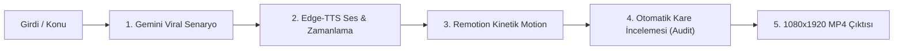

# 🎬 Gemini Tek Komut Otonom Video Üretim Sistemi (PROMPT_SYSTEM.md)

Bu doküman, herhangi bir konuyu veya `files/` klasörüne bırakılan bir girdiyi **tek bir komutla** viral, ultra-profesyonel bir dikey videoya (Reels/Shorts/TikTok) dönüştürmek için tasarlanmış kuralları, prompt kalıplarını ve denetim protokolünü içerir.

---

## ⚡ 1. Tek Komutla Çalışma Prensibi

Kullanıcı sadece şunu söylediğinde:
> *"Bana [X Konusu] hakkında bir video yap"* veya *"files altındaki dosyadan video üret"*

Sistem hiçbir ek soru sormadan aşağıdaki **5 Aşamalı Otonom Hattı** çalıştırır:



---

## 🎥 1.1. Yeni: Sinematik Motion Direktör Modu (CINEMATIC_PROMPT_SYSTEM.md)

Herhangi bir konuyu **Hollywood kalitesinde sinematik animasyonlu**, **kinetik tipografili (kinetic typography)**, **morfolojik şekil geçişli (@remotion/paths)**, **anlatımın gerektirdiği yerlerde 3D uzamsal elementli (CSS 3D / isometric)** ve **akıcı sanal kamera hareketli (FluidCamera)** bir başyapıta dönüştürmek için tasarlanmış özel sistem:

👉 **Ayrıntılı Rehber ve Master Prompt:** [CINEMATIC_PROMPT_SYSTEM.md](file:///d:/apps/remotion/CINEMATIC_PROMPT_SYSTEM.md)

* **Fluid Camera:** Yavaş gerilim yaklaşması (Dolly-in), parallax pan ve nefes alan el kamerası mikro-titremesi (`enableMicroDrift`).
* **Kinetic Typography:** Ritimle ekrana çarpan scale punch (`1.4 -> 1.0`), kademeli harf dökülüşü ve parlayan neon vurgular (`highlightWord`).
* **Morphing Shapes:** `@remotion/paths` ile SVG şekil morfolojisi (`circle` -> `hexagon`, `square` -> `chip`, `star` -> `shield`).
* **Gerektiği Yerde 3D:** Anlatımın derinlik ve mimari gerektirdiği sahnelerde `Scene3DContainer` ile izometrik 3D uzay.
* **Tek Komutla Sinematik Üretim:**
  ```bash
  node scripts/generate_script.mjs "Kuantum Dolanıklığı" --cinematic
  ```


---

## 📝 2. Gemini Viral Senaryo & Yapılandırma Promptu

Her video için kullanılacak standart sistem promptu:

```markdown
Rol: 10 milyon izlenmeli dikey kısa video (Reels/Shorts/TikTok) kreatif yönetmeni ve kurgucususun.
Görev: Verilen konu veya kaynaktan 45-55 saniyelik, retention oranı (%85+) tavan yapacak bir video metni oluştur.

Tasarım ve Anlatım Kuralları:
1. 0-2/3 SANİYE (Zorunlu Sorun & Paradoks Odaklı Kanca Formülü):
   * Her videonun ilk 1-2 saniyesinde mutlaka **konuya özel somut bir sorun, çelişki veya paradoks** ortaya konmalıdır!
   * Asla düz konu tanıtımı yapılmaz; izleyicinin aklını kurcalayacak ezber bozan bir problem sorulur.
   * **Formül:** `[Çarpıcı Sorun / Paradoks / Mantık Çelişkisi]` + `["Hiç merak ettin mi?" / "İşte kimsenin bilmediği o detay..." / "Cevabı ezber bozuyor..."]`
   * **Örnekler:**
     - *Havacılık:* "Bir uçağın tüm motorları havada aniden dursa bile neden hemen yere çakılmaz, hiç merak ettin mi?"
     - *Tarih:* "Yıllardır İnkılapçılığı durmadan değişmek sanıyoruz, peki Atatürk'ün resmi belgeleri neden tam tersini söylüyor?"
     - *Yazılım:* "Dünya genelindeki tüm bankacılık işlemlerinin 60 yıllık tek bir kod diliyle ayakta kaldığını biliyor muydun?"
     - *Biyoloji / Psikoloji:* "Odaya girdiğinde ne alacağını bir anda neden unutursun? Beynindeki bu açık kapı etkisini hiç merak ettin mi?"
   * Bu soru doğrudan izleyiciyi videoya kilitler; ardından 3. saniyeden itibaren hızlı ve tempolu çözüm anlatımına geçilir.

2. RİTİM: Her cümle 5-8 kelimeyi geçmeyen vurucu parçalar olmalı.

3. GÖRSEL DÜZEN & HİYERARŞİ (Metin Çakışması Yasağı):
   - Üst kartlarda ASLA uzun paragraf metni kullanılmaz! İki metin bloğunun birbiriyle yarışması engellenir.
   - Üst alan TAMAMEN GÖRSELLEŞTİRME içindir: İkili karşılaştırma grafikleri (❌ Şehir Efsanesi vs ✅ Tarihi Gerçek), arşiv illüstrasyonları (📜, ✍️, ⚖️), infografikler ve damgalar.
   - Okuma odağı sadece alt-orta alandaki Kinetik Altyazıdadır.

4. SES & METİN SENKRONİZASYONU (Soluklanma ve Cümle Ayrımı):
   - Noktalama işaretleri (. ! ?) kesin kuraldır. Bir cümle bittiğinde, o cümlenin kelimeleri kesinlikle sonraki cümleyle AYNI KUTUDA birleştirilemez!
   - Konuşmacı nefes alıp durakladığında sonraki cümlenin kelimeleri ekrana erken GELEMEZ. Sadece ses başladığında yeni grup ekrana gelir.

5. DİL: Türkçe karakter kurallarına (İ, ğ, ş, ç, ö, ü) ve dinamik konuşma diline tam uyumlu.

6. KAPANIŞ KURALI & KLİŞE ETKİLEŞİM YASAĞI (Anti-Cliche Ending):
   - **KESİNLİKLE YASAKTIR:** Videoların sonunda ASLA "Sen bu farkı biliyor muydun?", "Yorumlara yaz", "Yorumlarda buluşalım", "Fikrini aşağıya bırak" gibi ucuz etkileşim dilenciliği (engagement bait) YAPILMAYACAK!
   - **DOĞRU KAPANIŞ (Mic-Drop / Çarpıcı Sentez):** Video, konunun özünü ve gerçeğini tek bir otoriter, sarsıcı ve akılda kalıcı cümleyle mühürleyerek aniden biter.
   - *Örnek Doğru Kapanış:* "Tarih, kulaktan dolma anılarla değil; bizzat kurucularının el yazısı ve kanunlaştırdığı resmi belgelerle okunur." (Nokta. Asil ve güçlü bir son.)

7. SÜRE LİMİTİ VE SES BİTİŞ = VİDEO BİTİŞ KURALI:
   - **Maksimum Tavan Sınır (Hard Cap):** Video süresi ASLA 2 dakikayı (120 saniye / 3600 kare) aşamaz.
   - **İdeal Süre Aralığı:** Tipik olarak 45 - 65 saniye arasıdır; derin konularda maksimum 80 - 100 saniyeye uzayabilir.
   - **Ses Bittiğinde Video Biter:** Seslendirme sanatçısı son kelimesini telaffuz ettiği anda video sonlanır (+0.3s doğal ses sönümleme payı). Asla arkada donuk boş ekran, devam eden boş müzik veya sessiz kareler bırakılamaz. Kompozisyon süresi (`durationInFrames`) doğrudan ses dosyasının son kelimesine göre dinamik olarak hesaplanır.

Çıktı Formatı (JSON):
{
  "category": "Kategori Rozeti (Örn: HAVACILIK SIRLARI / EZBER BOZAN TARİH)",
  "problemHook": "İlk 1-2 saniye sorun/paradoks cümlesi (Örn: Uçak motoru kapansa bile neden düşmez, hiç merak ettin mi?)",
  "fullScript": "Tüm seslendirilecek metin (aralıksız, akıcı)",
  "illustrations": [
    {
      "type": "myth_buster | archive_document | comparison | diagram | poll_cta",
      "title": "Görsel Başlık",
      "startSec": 3.5,
      "endSec": 14.5
    }
  ]
}
```

---

## 🎨 3. Tasarım Kuralları & Tema Sistemi (Değiştirilebilir Yapı)

Sistem modüler tema mimarisiyle çalışır (`src/theme.ts`). Tek bir parametreyle veya `npm run create` arayüzünden istenen mimari seçilebilir:

---

### 🏛️ Stil 1: Neo-Brutalism (Aktif & Varsayılan)
Sert gölgeler, kalın çerçeveler, yüksek kontrast ve cesur pop-art estetiği.
* **Renk Paleti & Oranları:**
  - `%50 — Warm Cream (#F4F0E6):` Videonun ana arka planı ve zemin kartları.
  - `%30 — Ink Black (#171717):` 4-6px sert çerçeveler, tipografi, sıfır-blur sert gölgeler (`box-shadow: 8px 8px 0px #171717`).
  - `%15 — Acid Yellow (#DFFF00):` Aktif altyazı kelimesi vurgusu, etiketler, CTA.
  - `%5 — Signal Orange (#FF5A36):` Damgalar, uyarılar, aciliyet rozetleri.
* **Biçim Kuralları:** Sıfır yumuşatma/blur, katı `8px 8px 0px` gölge, `18px` border radius, `Montserrat 800/900`.

---

### 💎 Stil 2: Glassmorphism & Motion Design
Yazılım, yapay zeka, finans ve derin teknoloji konuları için buzlu cam (frosted glass) ve neon parıltılar.
* **Renk Paleti & Oranları:**
  - `%55 — Deep Void (#0A0D14):` Derin koyu arka plan.
  - `%25 — Pure White (#FFFFFF) & Muted Slate (#94A3B8):` Tipografi ve cam kart sınırları.
  - `%15 — Neon Cyan (#00F2FE):` Kinetik kelime aydınlatması, parıltı (glow) efektleri.
  - `%5 — Electric Purple (#9D4EDD):` Arka plan ambient ışık küreleri ve ikincil vurgu.
* **Biçim Kuralları:** `backdrop-filter: blur(20px)`, `border: 1.5px solid rgba(255,255,255,0.2)`, `box-shadow: 0 20px 50px rgba(0,0,0,0.6)`, `24px` yuvarlatılmış köşeler.

---

### 📐 Stil 3: Swiss / International Typographic Style
Bilim, felsefe, belgesel ve veri odaklı konular için modernist ızgara, katı asimetri ve İsviçre Kırmızısı.
* **Renk Paleti & Oranları:**
  - `%60 — Modernist Off-White (#F5F5F7):` Arka plan.
  - `%25 — Strict Black (#0F0F0F):` Net ızgara çizgileri, gövde metinleri ve sert çerçeveler.
  - `%10 — Swiss Red (#E30613):` İsviçre kırmızısı vurgu kutusu, önemli tarihler ve sayılar.
  - `%5 — Neutral Gray (#525252):` Alt başlıklar ve teknik etiketler.
* **Biçim Kuralları:** Keskin köşeler (`borderRadius: 4px`), 2px katı siyah sınırlar, asimetrik tipografik hizalama, sıfır süsleme, maksimum okunabilirlik.

---

### 🌿 Stil 4: Organic / Warm Minimalism
Psikoloji, edebiyat, kişisel gelişim, tarih ve yaşam felsefesi için sakin, topraksı ve huzurlu akış.
* **Renk Paleti & Oranları:**
  - `%55 — Warm Oat / Sand (#EFECE6):` Doğal keten ve kum rengi arka plan.
  - `%25 — Deep Espresso (#2A2421):` Yumuşak kahve-siyah gövde metinleri.
  - `%12 — Terracotta (#C86D51):` Pişmiş toprak rengi vurgular ve aktif kelime kapsülü.
  - `%8 — Sage Green (#7D8C71):` Adaçayı yeşili ikincil kartlar ve sakinleştirici rozetler.
* **Biçim Kuralları:** Yumuşak organik kavisler (`borderRadius: 28px`), doğal gölgeler (`rgba(42,36,33,0.06)`), ince sıcak sınırlar (`#DDD7CD`).

---

## 🎙️ 4. Çoklu Motor Seslendirmen Kataloğu (`config/voices.json`)

Sistem, **3 farklı yapay zeka ses sağlayıcısını** destekler. Seçilen seslendirmenin tüm bilgileri `public/voice_metadata.json` içerisine mühürlenir:

### A) 🆓 Hazır & Ücretsiz Nöral Motor (Edge-TTS — Anahtarsız)
| Seslendirmen | Model Anahtarı | Tip | Karakter & Tonlama |
| :--- | :--- | :--- | :--- |
| **Ava** | `en-US-AvaMultilingualNeural` | Kadın | **Varsayılan.** Microsoft Copilot'un ultra-doğal, akıcı podcast kadın tonu |
| **Emel** | `tr-TR-EmelNeural` | Kadın | Net, kurumsal, anlaşılır Microsoft yerel Türkçe kadın sesi |
| **Ahmet** | `tr-TR-AhmetNeural` | Erkek | Otoriter, derin, tarih ve belgesel anlatımları için karizmatik erkek sesi |
| **Andrew** | `en-US-AndrewMultilingualNeural` | Erkek | Sıcak, samimi, teknoloji ve iş dünyası videoları için çok dilli erkek sesi |
| **Brian / Emma** | Multilingual Neural | Erkek / Kadın | Sohbet tonunda samimi veya neşeli dinamik sesler |

### B) 🤖 Google Gemini 2.0 AI Motoru (`GEMINI_API_KEY`)
| Seslendirmen | Model | Tip | Karakter & Tonlama |
| :--- | :--- | :--- | :--- |
| **Puck** | `gemini-2.0-flash` | Erkek | Dinamik, merak uyandırıcı, karizmatik anlatıcı |
| **Charon** | `gemini-2.0-flash` | Erkek | Derin, vakur, belgesel ve felsefe için otoriter ses |
| **Kore** | `gemini-2.0-flash` | Kadın | Doğal, empatik, sıcak ve dinlendirici kadın sesi |
| **Fenrir** | `gemini-2.0-flash` | Erkek | Güçlü, vurgulu ve heybetli epik anlatıcı |
| **Aoede** | `gemini-2.0-flash` | Kadın | Berrak, melodik ve akıcı anlatım |

### C) 💬 OpenAI / ChatGPT AI Motoru (`OPENAI_API_KEY`)
| Seslendirmen | Model | Tip | Karakter & Tonlama |
| :--- | :--- | :--- | :--- |
| **Alloy** | `tts-1` | Nötr | ChatGPT'nin en bilinen orijinal dengeli tonu |
| **Nova** | `tts-1` | Kadın | Enerjik, genç ve yüksek retention sağlayan kadın sesi |
| **Onyx** | `tts-1` | Erkek | Tok, ciddi ve güven verici derin erkek sesi |
| **Shimmer** | `tts-1` | Kadın | Sıcak, berrak ve tane tane konuşan kadın sesi |

---

## 🔍 5. Kendi Kendini Denetleme (Self-Audit) Protokolü

Sistem render almadan önce şu kontrolleri otomatik olarak yapar:
1. `node scripts/audit_frames.mjs` çalıştırılarak 5 kilit kare yakalanır:
   * Kare 60 (Hook)
   * Kare 250 (1. Bilgi Kartı)
   * Kare 580 (2. Bilgi Kartı)
   * Kare 1000 (3. Bilgi Kartı)
   * Kare 1400 (Kapanış & Sentez)
2. **Yapay Zeka Görsel Analizi:**
   * Türkçe karakterler (özellikle İ, Ğ, Ş) doğru çizildi mi?
   * Altyazı ile bilgi kartları üst üste biniyor mu?
   * Equalizer ve parçacıklar hareket ediyor mu?
3. Eksik varsa kodda anında düzeltilir, ardından `npm run render` ile nihai MP4 basılır.

---

## 🚀 6. Kullanım Komutları

* **İnteraktif Video Üretimi (Adım Adım Sihirbaz):**
  ```bash
  npm run create
  # veya
  npm start
  ```
  *(Sırasıyla konuyu/dosyayı, Apify araştırmasını, 4 tasarım stilini ve Ava/Emel/Ahmet gibi seslendirmenleri sorar ve üretir.)*

* **Doğrudan Seslendirme Testi:**
  ```bash
  python scripts/generate_audio.py ava     # Ava (Ultra-Doğal Kadın)
  python scripts/generate_audio.py emel    # Emel (Yerel Türkçe Kadın)
  python scripts/generate_audio.py ahmet   # Ahmet (Karizmatik Erkek)
  ```

* **Canlı Önizleme Stüdyosu:**
  ```bash
  npm run dev
  ```

