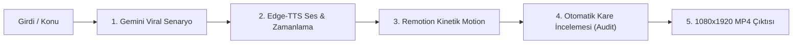

# 🎬 Gemini Tek Komut Otonom Video Üretim Sistemi (PROMPT_SYSTEM.md)

Bu doküman, herhangi bir konuyu veya `files/` klasörüne bırakılan bir girdiyi **tek bir komutla** viral, ultra-profesyonel bir dikey videoya (Reels/Shorts/TikTok) dönüştürmek için tasarlanmış kuralları, prompt kalıplarını ve denetim protokolünü içerir.

---

## ⚡ 1. Tek Komutla Çalışma Prensibi

Kullanıcı sadece şunu söylediğinde:
> *"Bana [X Konusu] hakkında bir video yap"* veya *"files altındaki dosyadan video üret"*

Sistem hiçbir ek soru sormadan aşağıdaki **5 Aşamalı Otonom Hattı** çalıştırır:



---

## 📝 2. Gemini Viral Senaryo & Yapılandırma Promptu

Her video için kullanılacak standart sistem promptu:

```markdown
Rol: 10 milyon izlenmeli dikey kısa video (Reels/Shorts/TikTok) kreatif yönetmeni ve kurgucususun.
Görev: Verilen konu veya kaynaktan 45-55 saniyelik, retention oranı (%85+) tavan yapacak bir video metni oluştur.

Tasarım ve Anlatım Kuralları:
1. 0-2/3 SANİYE (Zorunlu Sorun & Paradoks Odaklı Kanca Formülü):
   * Her videonun ilk 1-2 saniyesinde mutlaka **konuya özel somut bir sorun, çelişki veya paradoks** ortaya konmalıdır!
   * Asla düz konu tanıtımı yapılmaz; izleyicinin aklını kurcalayacak ezber bozan bir problem sorulur.
   * **Formül:** `[Çarpıcı Sorun / Paradoks / Mantık Çelişkisi]` + `["Hiç merak ettin mi?" / "İşte kimsenin bilmediği o detay..." / "Cevabı ezber bozuyor..."]`
   * **Örnekler:**
     - *Havacılık:* "Bir uçağın tüm motorları havada aniden dursa bile neden hemen yere çakılmaz, hiç merak ettin mi?"
     - *Tarih:* "Yıllardır İnkılapçılığı durmadan değişmek sanıyoruz, peki Atatürk'ün resmi belgeleri neden tam tersini söylüyor?"
     - *Yazılım:* "Dünya genelindeki tüm bankacılık işlemlerinin 60 yıllık tek bir kod diliyle ayakta kaldığını biliyor muydun?"
     - *Biyoloji / Psikoloji:* "Odaya girdiğinde ne alacağını bir anda neden unutursun? Beynindeki bu açık kapı etkisini hiç merak ettin mi?"
   * Bu soru doğrudan izleyiciyi videoya kilitler; ardından 3. saniyeden itibaren hızlı ve tempolu çözüm anlatımına geçilir.

2. RİTİM: Her cümle 5-8 kelimeyi geçmeyen vurucu parçalar olmalı.

3. GÖRSEL DÜZEN & HİYERARŞİ (Metin Çakışması Yasağı):
   - Üst kartlarda ASLA uzun paragraf metni kullanılmaz! İki metin bloğunun birbiriyle yarışması engellenir.
   - Üst alan TAMAMEN GÖRSELLEŞTİRME içindir: İkili karşılaştırma grafikleri (❌ Şehir Efsanesi vs ✅ Tarihi Gerçek), arşiv illüstrasyonları (📜, ✍️, ⚖️), infografikler ve damgalar.
   - Okuma odağı sadece alt-orta alandaki Kinetik Altyazıdadır.

4. SES & METİN SENKRONİZASYONU (Soluklanma ve Cümle Ayrımı):
   - Noktalama işaretleri (. ! ?) kesin kuraldır. Bir cümle bittiğinde, o cümlenin kelimeleri kesinlikle sonraki cümleyle AYNI KUTUDA birleştirilemez!
   - Konuşmacı nefes alıp durakladığında sonraki cümlenin kelimeleri ekrana erken GELEMEZ. Sadece ses başladığında yeni grup ekrana gelir.

5. DİL: Türkçe karakter kurallarına (İ, ğ, ş, ç, ö, ü) ve dinamik konuşma diline tam uyumlu.

6. KAPANIŞ KURALI & KLİŞE ETKİLEŞİM YASAĞI (Anti-Cliche Ending):
   - **KESİNLİKLE YASAKTIR:** Videoların sonunda ASLA "Sen bu farkı biliyor muydun?", "Yorumlara yaz", "Yorumlarda buluşalım", "Fikrini aşağıya bırak" gibi ucuz etkileşim dilenciliği (engagement bait) YAPILMAYACAK!
   - **DOĞRU KAPANIŞ (Mic-Drop / Çarpıcı Sentez):** Video, konunun özünü ve gerçeğini tek bir otoriter, sarsıcı ve akılda kalıcı cümleyle mühürleyerek aniden biter.
   - *Örnek Doğru Kapanış:* "Tarih, kulaktan dolma anılarla değil; bizzat kurucularının el yazısı ve kanunlaştırdığı resmi belgelerle okunur." (Nokta. Asil ve güçlü bir son.)

Çıktı Formatı (JSON):
{
  "category": "Kategori Rozeti (Örn: HAVACILIK SIRLARI / EZBER BOZAN TARİH)",
  "problemHook": "İlk 1-2 saniye sorun/paradoks cümlesi (Örn: Uçak motoru kapansa bile neden düşmez, hiç merak ettin mi?)",
  "fullScript": "Tüm seslendirilecek metin (aralıksız, akıcı)",
  "illustrations": [
    {
      "type": "myth_buster | archive_document | comparison | diagram | poll_cta",
      "title": "Görsel Başlık",
      "startSec": 3.5,
      "endSec": 14.5
    }
  ]
}
```

---

## 🎨 3. Tasarım Kuralları & Tema Sistemi (Değiştirilebilir Yapı)

Sistem modüler tema mimarisiyle çalışır (`src/theme.ts`). İstenen tema kolayca değiştirilebilir.
**Aktif ve Varsayılan Temamız:** **Neo-Brutalism**

### 🎯 Neo-Brutalism Renk Paleti (Değişkenler):
```typescript
export const THEME_COLORS = {
  WARM_CREAM:    "#F4F0E6", // %50 — Ana arka plan ve geniş içerik zeminleri
  INK_BLACK:     "#171717", // %30 — Sert çerçeveler, ana metinler, sert gölgeler
  ACID_YELLOW:   "#DFFF00", // %15 — Vurgulu kelimeler, aktif altyazı kutusu, CTA
  SIGNAL_ORANGE: "#FF5A36", // %5  — Uyarılar, tarihi damgalar, karşıt görüşler
  PURE_WHITE:    "#FFFFFF", // Ters kontrastlı alanlar ve vurgulu metinler
};
```

### ⚖️ Renk Kullanım Oranları:
* **%50 — Warm Cream (`#F4F0E6`):** Videonun ana arka planı ve ana kart zeminleri. Gözü yormayan retro-modern sıcak ton.
* **%30 — Ink Black (`#171717`):** Tipografi başlıkları, 4px sert çerçeveler (`border: 4px solid #171717`) ve sıfır bulanıklıklı sert açılı gölgeler (`box-shadow: 6px 6px 0px #171717`).
* **%15 — Acid Yellow (`#DFFF00`):** O an konuşulan kelimenin arkasındaki yüksek kontrastlı parlak kutu, öne çıkan etiketler, CTA elementleri.
* **%5 — Signal Orange (`#FF5A36`):** Tarihi arşiv damgaları (`HistoricalStamp`), acil uyarı rozetleri, karşıt fikirler.
* **Pure White (`#FFFFFF`):** Siyah zemin üzerindeki ters kontrastlı alanlar.

### 📐 Neo-Brutalism Biçimsel Kuralları:
1. **Sert Gölge (Hard Shadow):** Asla yumuşak `blur` veya şeffaf gölge kullanılmaz. Daima `box-shadow: 6px 6px 0px #171717` veya `8px 8px 0px #171717` kullanılır.
2. **Belirgin Çerçeve (Heavy Border):** Kartlar, rozetler ve damgalar en az `3px` ile `5px` arası katı siyah (`#171717`) çerçeveye sahiptir.
3. **Tipografi (Türkçe Tam Uyum):**
   * Font: `Montserrat` (Ağırlık: 800/900 Latin-Extended).
   * Büyük harfe çevirirken daima `.toLocaleUpperCase("tr-TR")` kullanılır (`İ` ve `I` harfleri bozulmaz).
4. **Kinetik Altyazı:**
   * Aktif kelime: `Acid Yellow (#DFFF00)` zeminli sert siyah çerçeveli kapsül kutu + `Ink Black (#171717)` metin rengi.
   * Pasif kelimeler: `Ink Black (#171717)` kalın metin.
5. **Dinamik Hareketli Grafikler:**
   * **Equalizer (AudioVisualizer):** `Acid Yellow` ve `Signal Orange` renkli, ses temposuna göre zıplayan 28 barlık frekans dalgası.
   * **Tarihi Damga (HistoricalStamp):** Belge çıktığında dönerek çarpan `Signal Orange (#FF5A36)` damga.
   * **Progress Bar:** Ekranın en üstünde `Signal Orange` ve `Acid Yellow` renk geçişli sert çerçeveli izleme çubuğu.

---

## 🔍 4. Kendi Kendini Denetleme (Self-Audit) Protokolü

Sistem render almadan önce şu kontrolleri otomatik olarak yapar:
1. `node scripts/audit_frames.mjs` çalıştırılarak 5 kilit kare yakalanır:
   * Kare 60 (Hook)
   * Kare 250 (1. Bilgi Kartı)
   * Kare 580 (2. Bilgi Kartı)
   * Kare 1000 (3. Bilgi Kartı)
   * Kare 1400 (CTA & Yorum Çağrısı)
2. **Yapay Zeka Görsel Analizi:**
   * Türkçe karakterler (özellikle İ, Ğ, Ş) doğru çizildi mi?
   * Altyazı ile bilgi kartları üst üste biniyor mu?
   * Equalizer ve parçacıklar hareket ediyor mu?
3. Eksik varsa kodda anında düzeltilir, ardından `npm run render` ile nihai MP4 basılır.

---

## 🚀 5. Kullanım Komutları

* **Yeni Video Üret (Tek Komut):**
  ```bash
  npm run generate
  ```
* **Kalite Kontrol Karelerini Al:**
  ```bash
  npm run audit
  ```
* **Canlı Önizleme Stüdyosu:**
  ```bash
  npm run dev
  ```
